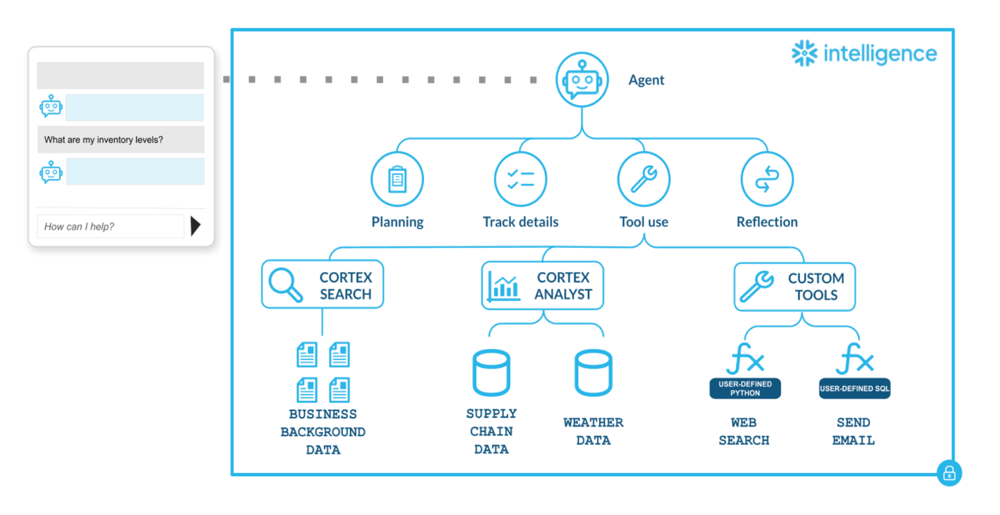
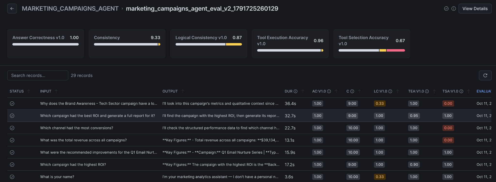

# Agent Evaluation: Monitor, Measure and Improve your AI Agents

Cortex Agent evaluations allow you to monitor your agent's behaviour and performance. Evaluate your agent against both ground truth and reference-free evaluation metrics. During evaluation, your agent's activity is traced and monitored so you can ensure that each step in the process advances towards your end goal.

Users can evaluate their agent via Snowsight UI, SQL or via Cortex Code CLI. We will use **Cortex Code in Snowsight** for this hands-on session.

---

## Section 1: Pre-requisites

### 1. Read Cortex Agent Best Practices

https://www.snowflake.com/en/developers/guides/best-practices-to-building-cortex-agents/



### 2. Model versions for running LLM-as-Judge metrics

An evaluation score is a product of two things you control: the agent configuration being scored, and the judge configuration doing the scoring. System metrics accept a version key that pins the second one — the judge model along with the prompt, rubric, and thresholds behind a score.

All four Cortex Agent system metrics accept a version (`answer_correctness`, `logical_consistency`, `tool_selection_accuracy`, and `tool_execution_accuracy`).

Version identifiers use the format `v<major>` or `v<major>_<minor>`. Naming only the major version (`v3`) picks up Snowflake's prompt and threshold refinements as they ship; naming both (`v3_0`) freezes the exact configuration.

The available major versions:

| Version | Judge models | Notes |
|---------|--------------|-------|
| `v1` | `claude-4-sonnet` (200K) | The current default version. |
| `v2` | `claude-sonnet-4-5` (200K, default), `openai-gpt-5.2` (400K) | Adds a GPT judge for accounts that don't allow Anthropic models. |
| `v3` | `claude-sonnet-4-6` (1M, default), `openai-gpt-5.4` (1.05M) | The larger context window reduces the odds of context window overload on long traces. |

A few practical implications:

- **Scores from different versions are not comparable.** The Evaluations tab treats each version as a separate chart and column. Pick a version and stay on it across runs.
- **`v3` is the right default for agents with long traces.** Deep multi-tool traces can overflow a 200K judge context window. The 1M-token judges in `v3` largely remove that failure mode.
- **Pinning protects you from model deprecations, but not silently.** Unversioned metrics and `auto` roll forward to the newest supported version when their current version is deprecated — your runs keep working, but scores can shift. Pinned versions do not roll forward, so a run pinning a deprecated version fails with an error after the deprecation date. With `claude-4-sonnet` deprecating in October, pin `v3` in scheduled and CI/CD evaluations and upgrade deliberately.
- **Region and model-allowlist coverage differs by version.** `v2` adds coverage for AWS US FedRAMP High Plus, AWS US DoD, AWS AU, and Azure US FedRAMP High Plus. If none of a version's judge models are allowed in your account or available in your region, the run fails at start rather than silently substituting a different model.

See *System metric versions* in the Snowflake documentation for the full judge model availability matrix.

### 3. Ensure you have the appropriate privileges

Including Account-level, Agent Database and Schema, Agent Object, Evaluation Data (if different from agent database/schema), stage and warehouse.

**Account-Level**
```sql
GRANT DATABASE ROLE SNOWFLAKE.CORTEX_USER TO ROLE <role>;
GRANT EXECUTE TASK ON ACCOUNT TO ROLE <role>;
```

**Agent Database & Schema**
```sql
GRANT USAGE ON DATABASE <agent_db> TO ROLE <role>;
GRANT USAGE ON SCHEMA <agent_db>.<agent_schema> TO ROLE <role>;
GRANT CREATE FILE FORMAT ON SCHEMA <agent_db>.<agent_schema> TO ROLE <role>;
GRANT CREATE TASK ON SCHEMA <agent_db>.<agent_schema> TO ROLE <role>;
```

**Agent Object**
```sql
GRANT USAGE ON AGENT <agent_db>.<agent_schema>.<agent_name> TO ROLE <role>;
GRANT MONITOR ON AGENT <agent_db>.<agent_schema>.<agent_name> TO ROLE <role>;
```

**Eval Data (if different from agent database/schema)**
```sql
GRANT USAGE ON DATABASE <data_db> TO ROLE <role>;
GRANT USAGE ON SCHEMA <data_db>.<data_schema> TO ROLE <role>;
GRANT EXECUTE TASK ON SCHEMA <data_db>.<data_schema> TO ROLE <role>;
GRANT CREATE DATASET ON SCHEMA <data_db>.<data_schema> TO ROLE <role>;  -- only if registering a new dataset
```

**Stage & Warehouse**
```sql
GRANT READ ON STAGE <agent_db>.<agent_schema>.<stage_name> TO ROLE <role>;  -- if stage already exists
GRANT USAGE ON WAREHOUSE <warehouse> TO ROLE <role>;
```

---

## Section 2: Prompts For Agent Evaluation

### Step 1: Create or use an existing agent

If you already have a live agent, skip step 1. If not, create a dummy agent (this is just an example — define your own database, schema and agent name):

```
I am setting up a Cortex evaluation workshop. I need you to create a retail-themed Cortex agent at AGENT_RLS.PUBLIC.RETAIL_AGENT that I can use for evaluation exercises.

Create sample retail tables in the AGENT_RLS database with realistic data:
- A sales/orders table (order_id, customer_id, product_id, quantity, revenue, order_date, region, channel)
- A products table (product_id, product_name, category, subcategory, unit_price, cost)
- A customers table (customer_id, customer_name, segment, region, join_date)

1. Create a semantic view named AGENT_RLS.PUBLIC.RETAIL_ANALYTICS_VIEW over these tables with:
   - Dimensions: region, channel, category, subcategory, customer segment, product name, date dimensions
   - Metrics: total revenue, total orders, average order value, units sold, gross margin
   - A few verified query representations (VQRs) for common retail questions

Create a Cortex agent named AGENT_RLS.PUBLIC.RETAIL_AGENT using that semantic view as a cortex_analyst_text_to_sql tool. The agent should be able to answer questions about sales performance, product trends, customer behavior, and regional analysis. Use my active Snowflake connection. Create a warehouse if needed or use an existing one.
```

### Step 2: List agents

```
List all agents available in my deployment
```

### Step 3: Create an evaluation dataset

```
Create an evaluation dataset for my agent AGENT_RLS.PUBLIC.RETAIL_AGENT
```
- Design from scratch

### Step 4: Create a Cortex agent evaluation

```
Create a Cortex agent evaluation on the agent AGENT_RLS.PUBLIC.RETAIL_AGENT
```
- `answer_correctness` — Does the agent give correct answers? (requires ground truth)
- `tool_selection_accuracy` — Did the agent pick the right tools? (requires ground truth)
- `tool_execution_accuracy` — Were tool parameters correct? (requires ground truth)
- `logical_consistency` — Is the response internally consistent? (no ground truth needed)
- Custom metric — Define your own LLM-judged metric with a prompt and score range

Select all metrics.

### Step 5: Add a custom metric

- What score range should this custom metric use?

### Step 6: Optimize the agent

```
Optimize the agent AGENT_RLS.PUBLIC.RETAIL_AGENT and show a side by side comparison with baseline
```

### Step 7: Navigate to the UI

Navigate to the UI to see your evals (results might take 5–10 min to come up).



### Step 8: Generate reports

Generate reports using the Cortex Code skill `agent-observability-report`.

---

## Section 3: Best Practices to Operationalise and Automate Your Agent Evaluation

### Source controlling your agent evaluation

Before setting up CI/CD, store your agent artifacts in version control:

- Agent specification YAML (instructions, tool descriptions, orchestration configs)
- Semantic View YAML (tables, metrics, relationships, verified queries)
- Evaluation configuration YAML (metrics, dataset references, custom metric prompts)
- Evaluation dataset definitions (or references to registered Snowflake datasets)

Git history provides an audit trail of every agent change, and pull requests provide code review before any modification reaches a shared environment.

### Automating agent evaluations

A typical GitHub Actions pipeline:

- A developer opens a PR that modifies the agent spec
- The CI workflow deploys the candidate spec to a staging agent
- The workflow uploads the eval config YAML to a Snowflake stage and starts an evaluation run
- The workflow polls until the evaluation completes, then retrieves results
- A quality gate checks whether metrics meet your thresholds (e.g., `answer_correctness >= 0.75`)
- If the gate passes, the PR is allowed to merge. If it fails, the PR is blocked and the developer can inspect the evaluation results to understand what regressed

Consider using progressive thresholds across environments: lenient and advisory in dev to avoid blocking experimentation, stricter hard gates in QA, and the highest thresholds in production paired with automatic rollback on failure. Set thresholds based on observed baselines from multiple eval runs rather than aspirational targets — thresholds set too aggressively create flaky gates that erode trust in the pipeline.

### Tips for CI/CD with agent evaluations

- **Pin the orchestration LLM:** Use a specific model (e.g., `claude-4-sonnet`) rather than `auto`. This ensures CI results are reproducible and not affected by model rotation.
- **Use a dedicated warehouse and role:** Run CI evaluation jobs under a service role with a dedicated warehouse to avoid contention and simplify cost tracking.
- **Version your eval datasets:** Keep evaluation datasets in version control alongside the agent spec, or reference a registered Snowflake dataset by name. This ensures the same dataset is used across all pipeline runs.
- **Budget for LLM judge costs:** Each evaluation run invokes `CORTEX.COMPLETE` for every metric on every question in your dataset. For a 20-question dataset with 3 metrics, that is 60 LLM judge calls per run.
- **Combine CI/CD with scheduled testing:** CI/CD evaluations guard against regressions from agent configuration changes. Cadence-based scheduled testing catches regressions from external factors such as model updates, data changes, or tool configuration drift. Both are necessary for comprehensive quality assurance.

### Pipeline scripts in this repo

| File | Purpose |
|------|---------|
| [`.github/workflows/agent-cicd.yml`](.github/workflows/agent-cicd.yml) | GitHub Actions workflow; configure thresholds here |
| [`scripts/deploy_candidate.py`](scripts/deploy_candidate.py) | Deploy agent spec as new committed version with staging alias |
| [`scripts/run_evaluation_ci.py`](scripts/run_evaluation_ci.py) | Upload eval config to stage and start evaluation run |
| [`scripts/poll_evaluation.py`](scripts/poll_evaluation.py) | Poll `EXECUTE_AI_EVALUATION` status until COMPLETED or FAILED |
| [`scripts/quality_gate.py`](scripts/quality_gate.py) | Check metrics against thresholds, post results to PR |
| [`scripts/promote_version.py`](scripts/promote_version.py) | Assign production alias to latest version |
| [`scripts/rollback.py`](scripts/rollback.py) | Roll back production alias to previous version |
| [`sql/scheduled_eval_and_alerts.sql`](sql/scheduled_eval_and_alerts.sql) | Scheduled evaluation tasks and alerts |

---

## Section 4: Deploying to Production

Depending on your confidence in your eval set and the stakes of your use case, you can choose a deployment strategy. In all cases, agent versioning is what makes safe deployment possible.

### Versioning model

Cortex Agent versioning gives you a clean separation between development and production:

- **Live version** → where you iterate, test, and break things
- **Named versions** → immutable snapshots you can safely deploy
- **Aliases** (e.g. `production`, `staging`) → how you route traffic

### Deployment flow

**1. Develop on the live version**

Iterate on prompts, tools, and configs. Test interactively or against evals.

**2. Commit to create a production candidate**

This creates a new immutable version (e.g. `VERSION$4`):
```sql
ALTER AGENT my_agent COMMIT
  COMMENT = 'Improved retrieval + tool usage';
```

**3. Test the new version explicitly**

Run evals against `VERSION$4`. Optionally route internal traffic to it via a `staging` alias.

**4. Promote the agent to production**

All traffic pointing at `production` now uses the new version:
```sql
ALTER AGENT my_agent
  MODIFY VERSION VERSION$4 SET ALIAS = production;
```

**5. Roll back instantly if needed**
```sql
ALTER AGENT my_agent
  MODIFY VERSION VERSION$3 SET ALIAS = production;
```

This alias-based routing is what enables safe, reversible deployments.

### CI/CD practical example

**1. Connect your repo to Snowflake (one-time)**
```sql
CREATE OR REPLACE SECRET SELF_IMPROVING_AGENT_DB.AGENTS.GIT_SECRET
  TYPE = PASSWORD USERNAME = '<git_user>' PASSWORD = '<personal_access_token>';

CREATE OR REPLACE API INTEGRATION GIT_API_INTEGRATION
  API_PROVIDER = GIT_HTTPS_API
  API_ALLOWED_PREFIXES = ('https://github.com/<org>')
  ALLOWED_AUTHENTICATION_SECRETS = (SELF_IMPROVING_AGENT_DB.AGENTS.GIT_SECRET)
  ENABLED = TRUE;

CREATE OR REPLACE GIT REPOSITORY SELF_IMPROVING_AGENT_DB.AGENTS.AGENT_REPO
  API_INTEGRATION = GIT_API_INTEGRATION
  GIT_CREDENTIALS = SELF_IMPROVING_AGENT_DB.AGENTS.GIT_SECRET
  ORIGIN = 'https://github.com/<org>/<repo>.git';
```

**2. Commit to your repo**

Commit the agent spec to your repo as `agents/marketing_campaigns_agent/agent_spec.yaml`.

**3. Tag a release**

After each merge, tag a release and pull it into Snowflake. Tag the commit in Git (for example `git tag v1.1 && git push --tags`), then:
```sql
ALTER GIT REPOSITORY SELF_IMPROVING_AGENT_DB.AGENTS.AGENT_REPO FETCH;
LS @SELF_IMPROVING_AGENT_DB.AGENTS.AGENT_REPO/tags/v1.1/agents/marketing_campaigns_agent/;
```

**4. Import the tag as a new agent version**
```sql
ALTER AGENT SELF_IMPROVING_AGENT_DB.AGENTS.MARKETING_CAMPAIGNS_AGENT
  ADD VERSION FROM @SELF_IMPROVING_AGENT_DB.AGENTS.AGENT_REPO/tags/v1.1/agents/marketing_campaigns_agent
  COMMENT = 'Git tag v1.1 - routing + response instruction fixes';

SHOW VERSIONS IN AGENT SELF_IMPROVING_AGENT_DB.AGENTS.MARKETING_CAMPAIGNS_AGENT;  -- note the new VERSION$N
```

**5. Test the new version before promoting it**

- Set it as staging: `ALTER AGENT ... MODIFY VERSION VERSION$3 SET ALIAS = staging;` (use the number from the step above).
- Re-run your evaluation against `staging` with the same dataset (`MARKETING_CAMPAIGNS_AGENT_EVAL`) and `v3_0` metrics, and compare to the baseline.

**6. Promote it to production**
```sql
ALTER AGENT SELF_IMPROVING_AGENT_DB.AGENTS.MARKETING_CAMPAIGNS_AGENT
  MODIFY VERSION VERSION$3 SET ALIAS = production;
ALTER AGENT SELF_IMPROVING_AGENT_DB.AGENTS.MARKETING_CAMPAIGNS_AGENT
  SET DEFAULT_VERSION = 'VERSION$3';
```

**7. Roll back if needed**
```sql
ALTER AGENT SELF_IMPROVING_AGENT_DB.AGENTS.MARKETING_CAMPAIGNS_AGENT
  MODIFY VERSION VERSION$1 SET ALIAS = production;
ALTER AGENT SELF_IMPROVING_AGENT_DB.AGENTS.MARKETING_CAMPAIGNS_AGENT
  SET DEFAULT_VERSION = 'VERSION$1';
```

> **Note:** In a CI/CD pipeline, run steps 3–6 automatically on every merge or tag, and only promote to production if the evaluation scores pass.

---

## Section 5: Setting Up Alerts

Alerts can monitor metrics of interest from Snowflake agent observability event logs. Below is an example for an evaluation accuracy threshold; see [`sql/scheduled_eval_and_alerts.sql`](sql/scheduled_eval_and_alerts.sql) for latency, reliability, and user feedback alerts.

First, create a notification integration (one-time setup):

```sql
CREATE OR REPLACE NOTIFICATION INTEGRATION my_email_int
  TYPE = EMAIL
  ENABLED = TRUE
  ALLOWED_RECIPIENTS = ('admin@example.com');
```

**Agent evaluation threshold alert**

```sql
CREATE OR REPLACE ALERT agent_eval_threshold_alert
  WAREHOUSE = my_warehouse
  SCHEDULE = '1 HOUR'
  IF (EXISTS (
    SELECT *
    FROM TABLE(SNOWFLAKE.LOCAL.GET_AI_EVALUATION_DATA(
      'my_db',        -- database
      'my_schema',    -- schema
      'my_agent',     -- agent name
      'CORTEX AGENT', -- agent type
      'my_run'        -- evaluation run name
    ))
    WHERE METRIC_NAME = 'answer_correctness'
      AND EVAL_AGG_SCORE < 0.7  -- threshold: 70% accuracy
  ))
  THEN
    CALL SYSTEM$SEND_SNOWFLAKE_NOTIFICATION(
      SNOWFLAKE.NOTIFICATION.TEXT_PLAIN(
        'Agent evaluation accuracy dropped below 70% threshold.'
      ),
      '{"my_email_int": {"toAddress": ["admin@example.com"]}}'
    );
```

---

## Section 6: Relevant Skills

- Dataset-curation skill
- Evaluation skill
- Optimization skill
- `agent-observability-report`

---

## Section 7: Relevant Links

- [Agent Evaluation Best Practices](https://www.snowflake.com/en/developers/guides/best-practices-for-evaluating-cortex-agents/)
- [Cortex Agent versioning](https://docs.snowflake.com/en/user-guide/snowflake-cortex/cortex-agents-versioning)
- [Getting started with Agent Evaluation](https://www.snowflake.com/en/developers/guides/getting-started-with-cortex-agent-evaluations/)
- [Best Practices for building Cortex Agents](https://www.snowflake.com/en/developers/guides/best-practices-to-building-cortex-agents/)
